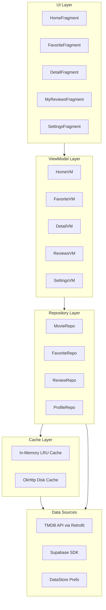
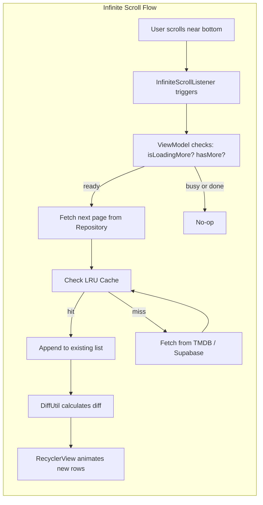
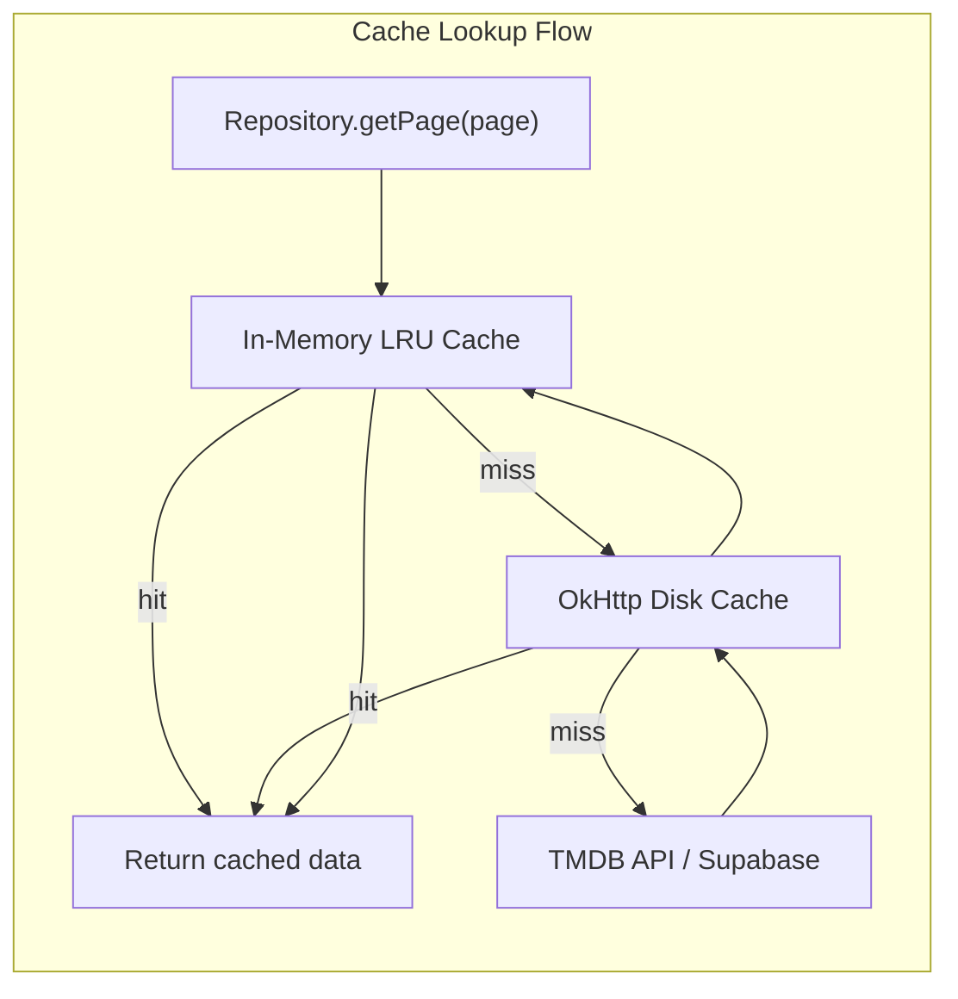

# Movie App Implementation Plan

## Architecture Overview

**Pattern**: MVVM + Repository + Clean Architecture layers  
**UI**: XML Views + Fragments + ViewBinding  
**Navigation**: Jetpack Navigation Component + BottomNavigationView  
**DI**: Hilt (Singleton / ViewModelScoped / FragmentScoped)  
**Networking**: Retrofit/OkHttp (TMDB, Bearer Access Token) + Supabase Kotlin SDK  
**Async**: Kotlin Coroutines + StateFlow  
**Image Loading**: Glide  
**Local prefs**: DataStore (theme, language)  
**Caching**: OkHttp disk cache + in-memory LRU cache  
**Pagination**: Manual cursor-based pagination (20 items/page for lists, 10 for reviews) with infinite scroll




---

## Design Patterns Checklist

Each pattern below is applied at a specific location. Check `[ ]` when implementation is complete.

- **MVVM** -- Each Fragment only observes `StateFlow` from its ViewModel; no direct repository or API calls from the UI
- **Repository Pattern** -- ViewModel only knows the Repository interface, not Retrofit or Supabase directly
- **Dependency Injection (Hilt)** -- All dependencies are injected; no manual `new` object creation
- **Singleton Pattern** -- `SupabaseClient`, `Retrofit`, `OkHttpClient`, `DataStore` are `@Singleton` in Hilt modules
- **Observer Pattern** -- UI observes `StateFlow<UiState>` from ViewModel; no callback chains
- **Adapter Pattern (Mapping)** -- `DTO -> Domain Model` mapping is done inside the Repository layer, keeping API responses separate from UI models
- **Strategy Pattern** -- `ThemeManager` applies the selected theme strategy (System/Light/Dark) via `AppCompatDelegate`
- **Factory Pattern** -- `UiState.Loading / Success / Error` sealed class acts as a state factory for each screen
- **Facade Pattern** -- Repository acts as a facade, hiding the complexity of TMDB API + Supabase + Cache behind a clean interface
- **Interceptor Pattern** -- OkHttp `Interceptor` for TMDB Bearer token auth + HTTP logging
- **ViewHolder Pattern** -- `ListAdapter` + `DiffUtil.ItemCallback` for efficient list diffing and RecyclerView updates
- **Delegation Pattern** -- Kotlin `by viewModels()` delegate for ViewModel instantiation in Fragments

---

## Memory Leak Prevention Checklist

Each point below must be verified during implementation. Check `[ ]` when verified.

### Fragment / ViewBinding

- **Null ViewBinding in `onDestroyView()`** -- Every Fragment must set `_binding = null` inside `onDestroyView()` to release the View hierarchy reference
- **No View reference in ViewModel** -- ViewModel holds only data and business logic; it must NOT reference Fragment, View, or Activity Context
- **Use `viewLifecycleOwner`** when collecting Flow or observing LiveData inside a Fragment (do NOT use `this` as the lifecycle owner)

### Coroutine Scopes

- `**viewModelScope**` -- All coroutines inside a ViewModel use `viewModelScope` (auto-cancelled when ViewModel is cleared)
- `**viewLifecycleOwner.lifecycleScope**` -- All coroutines inside a Fragment use this scope (auto-cancelled when View is destroyed)
- **Never use `GlobalScope`** -- GlobalScope is strictly forbidden anywhere in the project

### Image Loading (Glide)

- **Bind Glide to lifecycle** -- Always use `Glide.with(fragment)` or `Glide.with(view)`, never `Glide.with(applicationContext)` inside a Fragment
- **Clear Glide in RecyclerView** -- Call `Glide.clear(imageView)` inside `onViewRecycled()` of each RecyclerView adapter to release bitmaps when items scroll offscreen

### Adapter / RecyclerView

- **No Activity/Fragment reference in Adapter** -- Adapters receive lambda callbacks only; they must not hold a reference to the Fragment or Activity
- **DiffUtil instead of `notifyDataSetChanged()`** -- Avoids full rebind; reduces memory churn and prevents flicker during pagination appends

### Supabase / Network

- **Supabase client is a Singleton** -- Never create a new `SupabaseClient` per request; always inject the single Hilt-provided instance
- **Network calls respect coroutine cancellation** -- Verify that both Retrofit and Supabase calls are properly cancelled when the parent coroutine scope is cancelled

### Misc

- **Unregister listeners** -- If any `BroadcastReceiver`, scroll listener, or observer is registered manually, it must be unregistered in `onDestroyView()` or `onDestroy()`
- **DataStore is a singleton** -- Only one `DataStore<Preferences>` instance across the entire app; always provided via Hilt

---

## Screens (from Figma)


| Screen           | Tab                     | Key Features                                                                                                                                                     |
| ---------------- | ----------------------- | ---------------------------------------------------------------------------------------------------------------------------------------------------------------- |
| **Home**         | Home icon               | Featured banner (backdrop + Play/Detail), search bar, "Trending Now" horizontal list with infinite scroll                                                        |
| **Favorites**    | Heart icon              | Vertical paginated list (20/page) with poster, title, rating, year, duration, genre, HD/DOLBY badge, director, play button                                       |
| **Movie Detail** | (navigated from others) | Poster, metadata, Watch Now, like/bookmark/share, Summary, Casts horizontal list, Reviews with rating breakdown and infinite scroll (10/page), Write review form |
| **My Reviews**   | Bookmark icon           | Total review count header, paginated review list (10/page) with infinite scroll, Edit/Delete/View actions                                                        |
| **Settings**     | Gear icon               | Profile card, Language picker, Theme switcher (System/Light/Dark), Logout                                                                                        |


---

## Phase 1: Project Setup and Dependencies

### 1.1 Update `gradle/libs.versions.toml`

- **Kotlin plugin** (align with AGP 9)
- **Hilt**: `com.google.dagger:hilt-android`, `hilt-compiler`, `hilt-android-gradle-plugin`
- **Retrofit**: `com.squareup.retrofit2:retrofit`, `converter-gson`
- **OkHttp**: `com.squareup.okhttp3:okhttp`, `logging-interceptor`
- **Supabase Kotlin SDK**: `io.github.jan-tennert.supabase:postgrest-kt`, `gotrue-kt` + Ktor engine (`io.ktor:ktor-client-okhttp`)
- **Navigation**: `androidx.navigation:navigation-fragment-ktx`, `navigation-ui-ktx`
- **Glide**: `com.github.bumptech.glide:glide`
- **Coroutines**: `org.jetbrains.kotlinx:kotlinx-coroutines-android`
- **Lifecycle**: `androidx.lifecycle:lifecycle-viewmodel-ktx`, `lifecycle-runtime-ktx`
- **DataStore**: `androidx.datastore:datastore-preferences`
- **Fragment KTX**: `androidx.fragment:fragment-ktx`

### 1.2 Update `build.gradle.kts` (root + app)

- Apply Hilt plugin and Kotlin KSP/kapt
- Enable `viewBinding` and `buildConfig` in `buildFeatures`
- Add all `implementation` / `kapt` entries

### 1.3 Environment Variables (user provides in `local.properties`)

```properties
TMDB_ACCESS_TOKEN=eyJhbGci...your_bearer_token_here
SUPABASE_URL=https://xxxxx.supabase.co
SUPABASE_ANON_KEY=eyJhbGci...your_anon_key_here
```

- **TMDB uses Bearer Access Token** -- NOT a query param `api_key=...`
- Keys are read via `buildConfigField` in `app/build.gradle.kts` and accessed as `BuildConfig.TMDB_ACCESS_TOKEN` etc.
- An OkHttp Interceptor automatically injects `Authorization: Bearer {TMDB_ACCESS_TOKEN}` on every TMDB request

---

## Phase 2: Package Structure

```
com.example.customproject/
├── MovieApp.kt                        (Application class + @HiltAndroidApp)
├── MainActivity.kt                    (Single Activity host, NavController + BottomNav)
├── data/
│   ├── remote/
│   │   ├── tmdb/
│   │   │   ├── TmdbApiService.kt      (Retrofit interface)
│   │   │   ├── TmdbAuthInterceptor.kt (Bearer token injector)
│   │   │   ├── dto/                   (TmdbMovieResponse, TmdbCreditsResponse, TmdbPagedResponse, etc.)
│   │   ├── supabase/
│   │       ├── dto/                   (FavoriteDto, ReviewDto, ProfileDto, WatchlistDto)
│   ├── repository/
│   │   ├── MovieRepository.kt         (TMDB + LRU cache)
│   │   ├── FavoriteRepository.kt      (Supabase favorites)
│   │   ├── ReviewRepository.kt        (Supabase reviews + likes)
│   │   ├── ProfileRepository.kt       (Supabase profiles)
│   │   ├── WatchlistRepository.kt     (Supabase watchlist)
│   ├── model/
│       ├── Movie.kt
│       ├── Cast.kt
│       ├── Review.kt
│       ├── Profile.kt
│       ├── PagedResult.kt             (generic wrapper: items + nextPage + hasMore)
├── di/
│   ├── NetworkModule.kt               (provides Retrofit, OkHttpClient, SupabaseClient)
│   ├── DataStoreModule.kt             (provides DataStore<Preferences> singleton)
├── ui/
│   ├── home/        (HomeFragment, HomeViewModel)
│   ├── favorite/    (FavoriteFragment, FavoriteViewModel)
│   ├── detail/      (MovieDetailFragment, MovieDetailViewModel)
│   ├── reviews/     (MyReviewsFragment, MyReviewsViewModel)
│   ├── settings/    (SettingsFragment, SettingsViewModel)
│   ├── auth/        (LoginFragment, RegisterFragment, AuthViewModel)
│   ├── adapter/
│       ├── MoviePosterAdapter.kt      (horizontal trending list, infinite scroll)
│       ├── FavoriteMovieAdapter.kt    (vertical favorites list, infinite scroll)
│       ├── ReviewAdapter.kt           (reviews on detail screen, infinite scroll)
│       ├── MyReviewAdapter.kt         (my reviews screen, infinite scroll)
│       ├── CastAdapter.kt             (horizontal cast list)
├── util/
    ├── Constants.kt
    ├── Extensions.kt                  (loadImage, formatDate, etc.)
    ├── ThemeManager.kt
    ├── InfiniteScrollListener.kt      (reusable RecyclerView.OnScrollListener)
```

---

## Phase 3: Data Layer

### 3.1 TMDB API Service (Retrofit + Bearer Token)

**Auth**: `TmdbAuthInterceptor` injects `Authorization: Bearer {ACCESS_TOKEN}` on every request.  
**Base URL**: `https://api.themoviedb.org/3/`

Key endpoints (all return paginated responses):

- `GET /trending/movie/week?page={page}` -- Trending list, 20 items/page
- `GET /movie/now_playing?page={page}` -- Featured banner pool
- `GET /movie/{id}` -- Movie detail (runtime, genres, overview)
- `GET /movie/{id}/credits` -- Cast list
- `GET /search/movie?query={q}&page={page}` -- Search results, debounced, 20/page

**TmdbAuthInterceptor**:

```kotlin
class TmdbAuthInterceptor(private val accessToken: String) : Interceptor {
    override fun intercept(chain: Interceptor.Chain): Response {
        val request = chain.request().newBuilder()
            .addHeader("Authorization", "Bearer $accessToken")
            .addHeader("accept", "application/json")
            .build()
        return chain.proceed(request)
    }
}
```

### 3.2 Pagination Model

A shared `PagedResult<T>` wrapper used across all paginated repositories:

```kotlin
data class PagedResult<T>(
    val items: List<T>,
    val currentPage: Int,
    val totalPages: Int,
    val hasMore: Boolean = currentPage < totalPages
)
```

ViewModel holds pagination state:

```kotlin
data class PagingState<T>(
    val items: List<T> = emptyList(),
    val currentPage: Int = 1,
    val isLoadingMore: Boolean = false,
    val hasMore: Boolean = true,
    val error: String? = null
)
```

### 3.3 Supabase Repositories (Paginated)

- **FavoriteRepository** -- `SELECT * FROM favorites WHERE user_id = ? ORDER BY created_at DESC LIMIT 20 OFFSET ?`
- **ReviewRepository (on Detail)** -- `SELECT * FROM reviews WHERE tmdb_id = ? ORDER BY created_at DESC LIMIT 10 OFFSET ?`
- **ReviewRepository (My Reviews)** -- `SELECT * FROM reviews WHERE user_id = ? ORDER BY created_at DESC LIMIT 10 OFFSET ?`
- **WatchlistRepository** -- CRUD on `watchlist` table (bookmark icon on detail screen)
- **ProfileRepository** -- Read/update `profiles`

Supabase pagination uses `.range(from, to)` where `from = (page-1)*pageSize` and `to = page*pageSize - 1`.

### 3.4 Domain Models

```kotlin
data class Movie(
    val id: Int, val title: String, val overview: String,
    val posterPath: String?, val backdropPath: String?,
    val releaseDate: String, val voteAverage: Double,
    val runtime: Int?, val genres: List<String>
)

data class Review(
    val id: Long, val userId: String, val tmdbId: Int,
    val rating: Double, val content: String,
    val createdAt: String, val updatedAt: String,
    val username: String?, val avatarUrl: String?
)

data class PagedResult<T>(
    val items: List<T>,
    val currentPage: Int,
    val totalPages: Int,
    val hasMore: Boolean = currentPage < totalPages
)
```

---

## Phase 4: UI Layer -- Screen by Screen

### 4.1 Navigation Setup

- `activity_main.xml`: `FragmentContainerView` (NavHost) + `BottomNavigationView` (4 tabs)
- `nav_graph.xml`: 5 destinations (Home, Favorites, My Reviews, Settings as tabs + MovieDetail as nested)
- `bottom_nav_menu.xml`: home, heart, bookmark-square, gear icons

### 4.2 Home Screen (`fragment_home.xml`)

- **Top section**: Full-width backdrop image with gradient overlay, movie title, "Play" + "Detail" buttons
- **Middle**: Search `EditText` with magnifier icon; input debounced at 400ms via `Flow.debounce(400).flatMapLatest { }`
- **Bottom**: "Trending Now" label + "See all", horizontal `RecyclerView` with infinite scroll

**Infinite scroll on trending horizontal list:**

- Page size: 20 items per page
- `InfiniteScrollListener` attached to the `LinearLayoutManager`; triggers `loadMoreTrending()` when last visible item is within 5 items of the end
- ViewModel appends new items to the existing list in `PagingState`; adapter calls `submitList(newFullList)` using DiffUtil

### 4.3 Favorites Screen (`fragment_favorite.xml`)

- Title "Favorite" at top
- Vertical `RecyclerView` with `item_favorite_movie.xml`: poster, title, star rating + score, year/duration/genre, HD/DOLBY badge, director, play button
- **Infinite scroll (20 items/page)**:
  - On launch: load first 20 favorites from Supabase, enrich each with TMDB movie details (use LRU cache to avoid re-fetching)
  - Scroll to bottom triggers load of next 20; spinner shown at bottom of list while loading
  - Appended items submitted to `FavoriteMovieAdapter` via DiffUtil -- no full list reload

### 4.4 Movie Detail Screen (`fragment_movie_detail.xml`)

- `NestedScrollView` wrapping all content
- Top: backdrop image + back button + "Movie" chip
- Info section: poster, title, rating, year/duration/genre, HD/DOLBY
- Action row: heart (favorite), bookmark (watchlist), share + "Watch Now" button
- Summary: overview text (expandable)
- Casts: horizontal `RecyclerView` -- all cast loaded at once (typically <20 items)
- Reviews section:
  - Rating breakdown: large score (9.7), 5-star bar chart
  - Review list as **vertical `RecyclerView` nested inside `NestedScrollView`** with `isNestedScrollingEnabled = false`
  - **Infinite scroll (10 reviews/page)**:
    - Initial load: 10 most recent reviews
    - As user scrolls down the `NestedScrollView`, detect near-bottom via `NestedScrollView.setOnScrollChangeListener`; trigger `loadMoreReviews()`
    - Loading indicator appended as a footer item in `ReviewAdapter`
- Write review: star rating widget + multiline `EditText` + "Submit" button

### 4.5 My Reviews Screen (`fragment_my_reviews.xml`)

- Header: large review count + "reviews" label (total count fetched once via `COUNT(*)`)
- Vertical `RecyclerView` with `item_my_review.xml`:
  - Movie thumbnail, "Movie: Title", date
  - Star rating + "Very good" label
  - Review preview text (2 lines, truncated)
  - Delete (red trash icon button), Edit (filled button), View (outlined button)
- **Infinite scroll (10 reviews/page)**:
  - First page loaded on `onViewCreated`
  - `InfiniteScrollListener` on `LinearLayoutManager` triggers `loadMoreMyReviews()` when near bottom
  - Footer item `LOADING` / `END` appended to adapter to show progress or "no more" state
  - Deleting a review removes it from local list immediately (optimistic update), then syncs Supabase delete; total count decremented

### 4.6 Settings Screen (`fragment_settings.xml`)

- Profile card: circular avatar (Glide), full name, DOB, email
- Language row: label + "English" chip (dropdown for future localization)
- Theme section: 3 radio-style cards (System Default / Light / Dark) with preview thumbnails
- Logout button at bottom
- `ThemeManager` reads/writes theme preference via DataStore; applies with `AppCompatDelegate.setDefaultNightMode()`

---

## Phase 5: Auth Flow

- Login and Register screens (email + password via Supabase GoTrue `auth.signInWithPassword` / `auth.signUpWith`)
- On app launch: check `supabase.auth.currentSessionOrNull()`
  - No session → navigate to LoginFragment
  - Session exists → navigate to HomeFragment
- On first login: if no row in `profiles` for `auth.uid()`, insert one with email and generated username
- Logout: call `supabase.auth.signOut()` → clear DataStore preferences → navigate to LoginFragment

---

## Phase 6: Theming and Styling

- Dark theme as default (matching Figma dark backgrounds `#121212` / `#1E1E1E`)
- `res/values-night/themes.xml` (dark) + `res/values/themes.xml` (light) using Material3 color scheme
- Accent color: teal/cyan (`#00BCD4` range) matching Figma
- Rounded corners (`12dp` cards, `24dp` buttons)
- Custom drawables: HD badge, DOLBY badge, star rating bar segments, gradient overlay for backdrop

---

## Phase 7: Data Optimization

### 7.1 Network Caching (OkHttp)

- **OkHttp disk cache** -- Configure `Cache(cacheDir, 50_000_000)` (50 MB) for TMDB API responses
- **Cache-Control Interceptor** -- Add `Cache-Control: max-age=3600` for trending/now_playing (stale after 1 hour); `max-age=86400` for movie detail (stale after 24 hours)
- **Offline fallback** -- Network Interceptor returns cached response when offline: `Cache-Control: public, only-if-cached, max-stale=604800` (7 days)

### 7.2 In-Memory LRU Cache

- **Movie detail cache** -- `LruCache<Int, Movie>(maxSize = 100)` inside `MovieRepository`; avoids re-fetching detail when navigating back to the same movie
- **Favorites enrichment cache** -- Reuse the same LRU cache when enriching the favorites list; avoids N TMDB calls every time the tab is reopened
- **Cache invalidation on refresh** -- Clear LRU entries on pull-to-refresh; also clear on `onTrimMemory(TRIM_MEMORY_MODERATE)` to avoid OOM

### 7.3 Infinite Scroll / Lazy Load Implementation

All lists that can grow large use the same scroll-triggered pagination pattern:

```
Page size: 20 items for movie lists (Trending, Favorites)
           10 items for review lists (Detail Reviews, My Reviews)
```

**Reusable `InfiniteScrollListener`**:

```kotlin
class InfiniteScrollListener(
    private val layoutManager: LinearLayoutManager,
    private val threshold: Int = 5,
    private val onLoadMore: () -> Unit
) : RecyclerView.OnScrollListener() {
    override fun onScrolled(recyclerView: RecyclerView, dx: Int, dy: Int) {
        if (dy <= 0) return
        val totalItems = layoutManager.itemCount
        val lastVisible = layoutManager.findLastVisibleItemPosition()
        if (lastVisible >= totalItems - threshold) onLoadMore()
    }
}
```

ViewModel load-more function example (Trending):

```kotlin
fun loadMoreTrending() {
    val state = _trendingState.value
    if (state.isLoadingMore || !state.hasMore) return
    viewModelScope.launch {
        _trendingState.update { it.copy(isLoadingMore = true) }
        val result = movieRepository.getTrending(state.currentPage + 1)
        _trendingState.update { current ->
            current.copy(
                items = current.items + result.items,
                currentPage = result.currentPage,
                hasMore = result.hasMore,
                isLoadingMore = false
            )
        }
    }
}
```

- **Trending list (Home)** -- TMDB `page` param; 20 items/page; horizontal RecyclerView with InfiniteScrollListener
- **Favorites list** -- Supabase `.range(from, to)`; 20 items/page; vertical RecyclerView with InfiniteScrollListener
- **Reviews on Detail** -- Supabase `.range(from, to)`; 10 items/page; scroll detection via NestedScrollView listener
- **My Reviews list** -- Supabase `.range(from, to)`; 10 items/page; vertical RecyclerView with InfiniteScrollListener
- **Search results** -- TMDB `page` param; 20 items/page; load more on scroll; reset to page 1 on new query

**Loading state in adapter**: Each paginated adapter has a `LOADING` footer item that shows a progress spinner at the bottom. When `hasMore = false`, footer is replaced with nothing (or "No more items"). The footer is managed by appending a `null` sentinel to the submitted list:

```kotlin
fun submitPagedList(items: List<Movie>, isLoadingMore: Boolean) {
    val list = if (isLoadingMore) items + listOf(null) else items
    submitList(list)
}
```

### 7.4 Search Debounce

- **Debounce 400ms** -- `Flow.debounce(400)` on search `EditText` text change events; avoids an API call per keystroke
- `**distinctUntilChanged()`** -- Skips re-fetch if query hasn't changed
- `**flatMapLatest`** -- Cancels the previous in-flight search request when a new query arrives

### 7.5 Image Optimization (Glide)

- **TMDB image sizing** -- Use `w342` or `w500` for posters; `w780` for backdrops; never use `original`
- **Disk cache strategy** -- `DiskCacheStrategy.AUTOMATIC` caches both source and transformed bitmaps
- **Placeholder + Error drawable** -- Prevents blank spaces during loading; improves perceived performance
- **Thumbnail preload** -- `Glide.with(fragment).load(url).thumbnail(0.25f)` for progressive image rendering

### 7.6 Efficient List Rendering

- `**ListAdapter` + `DiffUtil.ItemCallback`** -- All RecyclerView adapters extend `ListAdapter`; diffing runs on a background thread
- `**onViewRecycled()` cleanup** -- Call `Glide.clear(imageView)` in `onViewRecycled()` to free bitmap memory when items leave the screen
- **Stable IDs** -- `setHasStableIds(true)` where adapters have a stable unique ID; helps RecyclerView avoid unnecessary rebinds during pagination appends
- `**isNestedScrollingEnabled = false`** on any RecyclerView inside a NestedScrollView (Detail screen reviews list)

### 7.7 StateFlow / Coroutine Optimization

- `**stateIn(SharingStarted.WhileSubscribed(5000))`** -- Flow stops emitting 5 seconds after the last subscriber (Fragment goes to background); restarts when Fragment returns to foreground
- `**flowOn(Dispatchers.IO)`** -- All network and database operations run on the IO dispatcher; never block the Main thread







---

## Key Files to Create / Modify


| File                                      | Action                                                                 |
| ----------------------------------------- | ---------------------------------------------------------------------- |
| `gradle/libs.versions.toml`               | Add all new dependency versions                                        |
| `build.gradle.kts` (root)                 | Add Hilt + Kotlin plugins                                              |
| `app/build.gradle.kts`                    | Add all dependencies, enable viewBinding + buildConfig                 |
| `AndroidManifest.xml`                     | Add INTERNET permission, declare Application class                     |
| `MovieApp.kt`                             | New -- Hilt Application class                                          |
| `MainActivity.kt`                         | Rewrite -- NavController + BottomNav setup                             |
| `activity_main.xml`                       | Rewrite -- NavHostFragment + BottomNavigationView                      |
| `nav_graph.xml`                           | New -- Navigation graph                                                |
| `menu/bottom_nav_menu.xml`                | New -- Bottom nav items                                                |
| `di/NetworkModule.kt`                     | New -- Hilt module (Retrofit, OkHttp, SupabaseClient)                  |
| `di/DataStoreModule.kt`                   | New -- Hilt module (DataStore singleton)                               |
| `data/remote/tmdb/TmdbApiService.kt`      | New -- Retrofit interface                                              |
| `data/remote/tmdb/TmdbAuthInterceptor.kt` | New -- Bearer token OkHttp interceptor                                 |
| `data/remote/tmdb/dto/*.kt`               | New -- API response DTOs (paged response, movie, credits)              |
| `data/remote/supabase/dto/*.kt`           | New -- Supabase table DTOs                                             |
| `data/model/*.kt`                         | New -- Domain models (Movie, Cast, Review, Profile, PagedResult)       |
| `data/repository/*.kt`                    | New -- 5 repositories                                                  |
| `ui/home/*`                               | New -- Fragment + ViewModel + Layout                                   |
| `ui/favorite/*`                           | New -- Fragment + ViewModel + Layout                                   |
| `ui/detail/*`                             | New -- Fragment + ViewModel + Layout                                   |
| `ui/reviews/*`                            | New -- Fragment + ViewModel + Layout                                   |
| `ui/settings/*`                           | New -- Fragment + ViewModel + Layout                                   |
| `ui/auth/*`                               | New -- Login/Register Fragment + ViewModel                             |
| `ui/adapter/InfiniteScrollListener.kt`    | New -- Reusable scroll threshold listener                              |
| `ui/adapter/MoviePosterAdapter.kt`        | New -- Horizontal trending list (infinite scroll, footer)              |
| `ui/adapter/FavoriteMovieAdapter.kt`      | New -- Vertical favorites list (infinite scroll, footer)               |
| `ui/adapter/ReviewAdapter.kt`             | New -- Reviews on detail screen (10/page, footer)                      |
| `ui/adapter/MyReviewAdapter.kt`           | New -- My Reviews list (10/page, footer)                               |
| `ui/adapter/CastAdapter.kt`               | New -- Horizontal cast list                                            |
| `util/Constants.kt`                       | New -- PAGE_SIZE_MOVIES=20, PAGE_SIZE_REVIEWS=10, BASE_IMAGE_URL, etc. |
| `util/Extensions.kt`                      | New -- loadImage(), formatRuntime(), etc.                              |
| `util/ThemeManager.kt`                    | New -- DataStore-backed theme persistence                              |
| `res/values/colors.xml`                   | Update -- App color palette                                            |
| `res/values/themes.xml`                   | Update -- Material3 dark/light themes                                  |
| `res/drawable/*.xml`                      | New -- Shapes, gradients, badges, star rating drawables                |


---

## Estimated Scope

- ~55-65 new/modified files
- 8 phases, built in order
- Each phase has `[ ]` checklist items to track progress
- Design patterns: 12 items to verify
- Memory leak prevention: 15 items to verify
- Data optimization + lazy load: 20 items to verify

